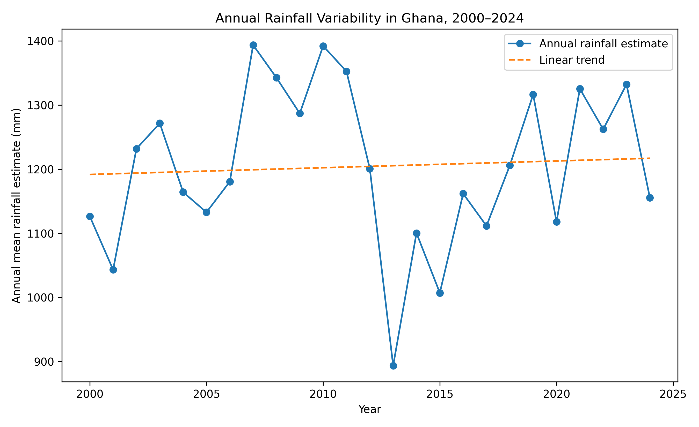
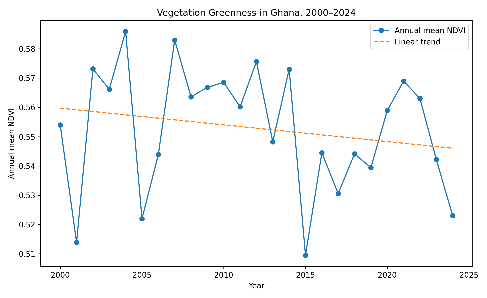
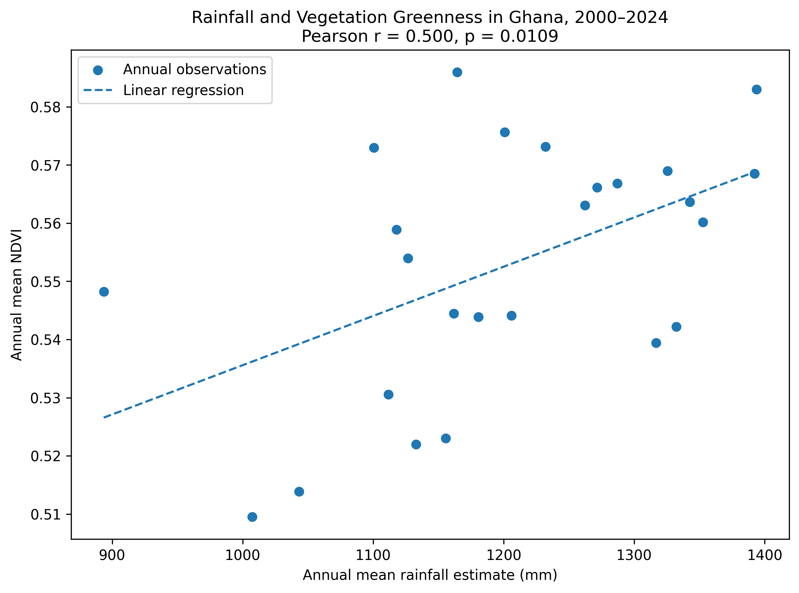

# Rainfall Variability and Vegetation Dynamics in Ghana (2000–2024)

## Project Overview

This project investigates the relationship between rainfall variability and satellite-derived vegetation greenness in Ghana from 2000 to 2024. It combines CHIRPS precipitation data with MODIS Normalized Difference Vegetation Index (NDVI) observations to explore how annual rainfall patterns relate to vegetation dynamics.

The project demonstrates an agricultural research workflow involving data validation, cleaning, exploratory analysis, statistical testing, visualization, and reproducible documentation using Python and Google Earth Engine.

## Research Objectives

1. Validate and summarize rainfall observations for Ghana.
2. Characterize annual rainfall variability and monthly seasonality from 2000 to 2024.
3. Examine annual vegetation greenness patterns using MODIS NDVI.
4. Evaluate the association between annual rainfall and NDVI.
5. Test the robustness of this association using detrending and leave-one-year-out sensitivity analysis.

## Data Sources

- **Rainfall:** CHIRPS precipitation data.
- **Vegetation:** MODIS MOD13Q1 NDVI product.
- **Study period:** 2000–2024.
- **Geographic scope:** Ghana.

## Methods and Tools

- Python and pandas for data processing.
- SciPy for statistical analysis.
- Google Colab for notebook-based analysis.
- Google Earth Engine for satellite data processing.
- Pearson and Spearman correlation.
- Linear trend analysis and leave-one-year-out sensitivity testing.

## Key Findings

- Mean annual rainfall estimate across the retained grid cells was approximately 1,204.5 mm.
- The estimated rainfall trend was +1.053 mm per year, but it was not statistically significant (p = 0.7692).
- Annual mean NDVI showed a slight negative linear trend of approximately −0.000570 NDVI units per year; this trend was not statistically significant (p = 0.3431).
- Annual rainfall and NDVI showed a moderate positive association (Pearson r = 0.5003, p = 0.0109).
- The positive association remained statistically significant after removing linear time trends (Pearson r = 0.5238, p = 0.0072).
- Leave-one-year-out correlations ranged from 0.4219 to 0.5574, with all 25 tests remaining significant at p < 0.05.
- ## Research Figures

### Figure 1. Annual Rainfall Trend in Ghana (2000–2024)

Annual rainfall estimates show year-to-year variability. The estimated linear trend was not statistically significant (p = 0.7692).

### Figure 2. Annual Vegetation Greenness Trend (2000–2024)

Satellite-derived annual mean NDVI showed a slight negative trend that was not statistically significant (p = 0.3431).

### Figure 3. Relationship Between Rainfall and Vegetation Greenness

Annual rainfall estimates and annual mean NDVI showed a moderate positive association (Pearson r = 0.5003, p = 0.0109). This association does not establish causation, and NDVI is not a direct measure of forage biomass or quality.

## Repository Structure

- `notebooks/` — Research analysis notebooks.
- `data/` — Processed rainfall and integrated rainfall–NDVI datasets.
- `results/` — Statistical summaries and robustness results.
- `docs/` — Research methods, interpretation, and limitations.

## Limitations

Correlation does not establish causation. National annual averages may conceal regional differences, and the analysis does not explicitly account for possible temporal autocorrelation.

NDVI measures vegetation greenness, not forage biomass, nutritional quality, or livestock-accessible forage. The NDVI valid-spatial-coverage calculation also requires further verification. Therefore, findings should be interpreted as evidence about rainfall and vegetation greenness, not as direct measurements of forage production.

## Reproducibility

The notebooks document the analytical workflow and the processed datasets and statistical outputs are provided in the repository. Source data should be attributed to their respective providers.

## Future Work

Potential extensions include spatial comparisons among Ghana's ecological zones, seasonal rainfall–NDVI analysis, evaluation of additional environmental variables, and validation against direct forage or field measurements.
